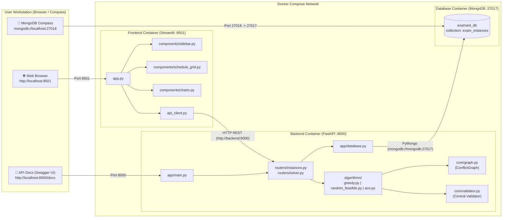
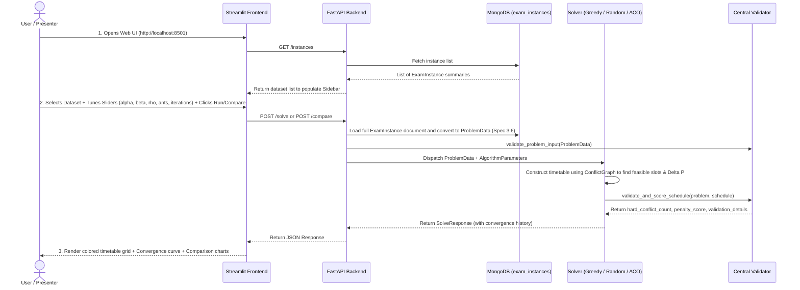

<p align="right">
  <b>🇬🇧 English</b> | <a href="03-system-architecture.th.md">🇹🇭 ภาษาไทย</a>
</p>

# 🏗️ System Architecture & Cross-Platform Port Configuration

This document outlines the system architecture, inter-service communications, end-to-end data flow, and port isolation strategy across the 3 Docker containers in **ExamAnt** (`mongodb`, `backend`, `frontend`).

---

## 1. System Architecture Diagram



---

## 2. End-to-End Data Flow



---

## 3. Cross-Platform Port Isolation (macOS & Windows)

Common environment issues when collaborating across operating systems:
1. **Ports `5000` and `7000` on macOS:** Utilized by macOS's native AirPlay Receiver service.
2. **Port `27017` on macOS and Windows:** Often collides with a locally installed MongoDB daemon.

To eliminate port contention, default ports in `.env` and `docker-compose.yml` are configured as follows:

| Service | Internal Container Port | Host Port Mapping | Environment Variable | Rationale |
| :--- | :---: | :---: | :--- | :--- |
| **MongoDB** | `27017` | **`27018`** | `MONGO_PORT=27018` | Avoids collision with local host MongoDB on `27017` |
| **FastAPI Backend** | `8000` | **`8000`** | `BACKEND_PORT=8000` | Safely avoids macOS AirPlay ports (`5000`/`7000`) |
| **Streamlit Frontend** | `8501` | **`8501`** | `FRONTEND_PORT=8501` | Standard Streamlit web port |

### Modifying Ports
If port `8000` or `8501` is occupied on your machine, edit `.env` in the root folder:
```env
MONGO_PORT=27019
BACKEND_PORT=8080
FRONTEND_PORT=8502
```
Re-run `docker compose up -d`. Inter-container communication (`http://backend:8000` and `mongodb://mongodb:27017`) remains unaffected.
