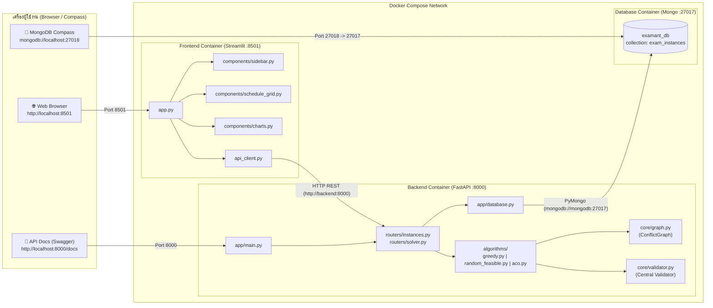
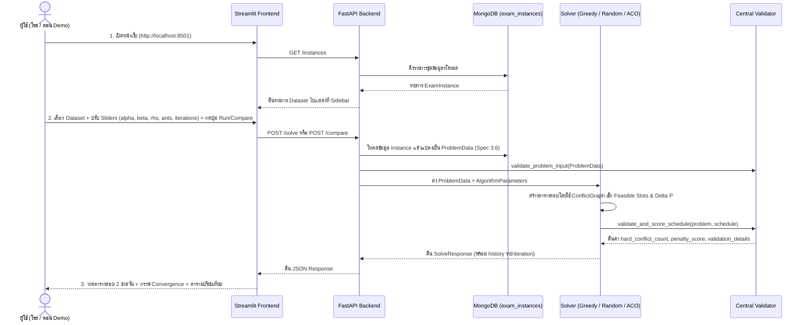

<p align="right">
  <a href="03-system-architecture.md">🇬🇧 English</a> | <b>🇹🇭 ภาษาไทย</b>
</p>

# 🏗️ สถาปัตยกรรมระบบ (System Architecture) และการตั้งค่าพอร์ต

เอกสารนี้อธิบายโครงสร้างการทำงานร่วมกันของทั้ง 3 คอนเทนเนอร์ในโปรเจกต์ **ExamAnt** (`mongodb`, `backend`, `frontend`) รวมถึงแนวทางการตั้งค่าพอร์ตเพื่อป้องกันปัญหาพอร์ตชนกันบน macOS และ Windows

---

## 1. แผนผังสถาปัตยกรรม (System Architecture Diagram)



---

## 2. ลำดับการทำงานตั้งแต่ต้นจนจบ (End-to-End Data Flow)



---

## 3. การจัดการพอร์ตสำหรับ macOS และ Windows (ป้องกันพอร์ตชน)

ปัญหาที่พบบ่อยเวลาทำโปรเจกต์กลุ่มข้าม OS (macOS vs Windows):
1. **พอร์ต `5000` และ `7000` บน macOS:** ถูกใช้งานโดยบริการ AirPlay Receiver ของระบบปฏิบัติการ macOS
2. **พอร์ต `27017` บนทั้ง macOS และ Windows:** มักชนกับบริการ MongoDB Server ที่ติดตั้งไว้ในเครื่องอยู่แล้ว

ดังนั้นเราจึงออกแบบพอร์ตเริ่มต้นในไฟล์ `.env` และ `docker-compose.yml` ดังนี้:

| บริการ | พอร์ตภายใน Docker | พอร์ตที่เปิดบนเครื่อง (Host Port) | ตัวแปรใน `.env` | เหตุผล |
| :--- | :---: | :---: | :--- | :--- |
| **MongoDB** | `27017` | **`27018`** | `MONGO_PORT=27018` | ไม่ชนกับ MongoDB ที่ลงไว้ในเครื่อง (`27017`) |
| **FastAPI Backend** | `8000` | **`8000`** | `BACKEND_PORT=8000` | หลีกเลี่ยงพอร์ต `5000`/`7000` ของ macOS AirPlay |
| **Streamlit Frontend** | `8501` | **`8501`** | `FRONTEND_PORT=8501` | พอร์ตมาตรฐานของ Streamlit |

### วิธีแก้ไขกรณีพอร์ต `8000` หรือ `8501` ชนกับโปรแกรมอื่นในเครื่อง
เพียงเปิดไฟล์ `.env` ที่โฟลเดอร์รากของโปรเจกต์ แล้วเปลี่ยนตัวเลข เช่น:
```env
MONGO_PORT=27019
BACKEND_PORT=8080
FRONTEND_PORT=8502
```
จากนั้นรัน `docker compose up -d` ใหม่ ตัว Container ภายในจะยังคงคุยกันผ่านเครือข่ายภายใน (`http://backend:8000` และ `mongodb://mongodb:27017`) ได้เหมือนเดิมโดยไม่ต้องแก้โค้ดแม้แต่บรรทัดเดียว!
