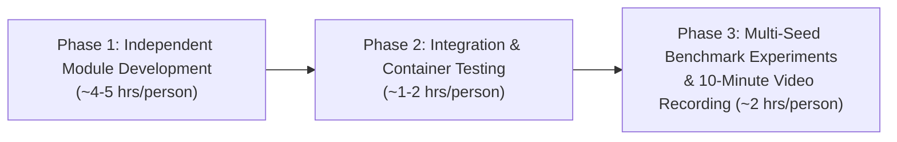

<p align="right">
  <b>🇬🇧 English</b> | <a href="00-tasks-overview.th.md">🇹🇭 ภาษาไทย</a>
</p>

# 👥 Team Task Breakdown & Workflow Overview

> **Course:** AI2 (2110477)  
> **Team Members:**  
> 1. 6631305321 Chanatda Konchom (Fai)  
> 2. 6632213421 Sasarose Buranapin (Rose)  
> 3. 6630333721 Sippapas Chavanont (Mai)  
>  
> This document summarizes the responsibilities of all 3 team members for **ExamAnt** within the 24 person-hour project budget, ensuring everyone can develop concurrently without blocking each other.

---

## 1. Roles & Core Responsibilities

| Member | Primary Role | Key Files | Assigned Feature Branch | Individual Task Guide |
| :--- | :--- | :--- | :--- | :--- |
| **6630333721 Sippapas Chavanont (Mai)** | Master technical specification, **ACO** & **Random Feasible** algorithms, `/solve` and `/compare` APIs | - `backend/app/algorithms/aco.py`<br>- `backend/app/algorithms/random_feasible.py`<br>- `backend/app/routers/solver.py` | `feat/aco-random-solvers` | 👉 [01-task-maimai-lead-aco.md](01-task-maimai-lead-aco.md) |
| **6631305321 Chanatda Konchom (Fai)** | Repo & Docker setup, **Dataset Generator (3 difficulty levels)** + **MongoDB Seeder**, **Greedy** baseline | - `docker-compose.yml`<br>- `backend/scripts/seed_db.py`<br>- `backend/scripts/sample_instances.json`<br>- `backend/app/algorithms/greedy.py` | `feat/dataset-seeder-greedy` | 👉 [02-task-fai-db-greedy.md](02-task-fai-db-greedy.md) |
| **6632213421 Sasarose Buranapin (Rose)** | **Streamlit Frontend**, 2-slots-per-day colored timetable grid, interactive charts, and benchmark evaluation report | - `frontend/app.py`<br>- `frontend/components/sidebar.py`<br>- `frontend/components/schedule_grid.py`<br>- `frontend/components/charts.py` | `feat/streamlit-frontend-viz` | 👉 [03-task-rose-frontend.md](03-task-rose-frontend.md) |

---

## 2. Git Workflow & Best Practices (Branch Naming & Commit Messages)

> Based on [Git Good: Best Practices for Branch Naming and Commit Messages](https://dev.to/shnjd/git-good-best-practices-for-branch-naming-and-commit-messages-oj4).

### 2.1 Branching Strategy
1. **Always pull latest `main` before branching:**
   ```bash
   git checkout main
   git pull origin main
   git checkout -b <branch-name>
   ```
2. **Branch Naming Pattern:** `<type>/<short-kebab-case-description>`
   - Use lowercase letters and hyphens `-` only (no uppercase, underscores, or spaces).
   - Common prefixes:
     - `feat/`: New feature, algorithm, or UI page (e.g., `feat/aco-random-solvers`)
     - `fix/`: Bug fixes (e.g., `fix/conflict-validator`)
     - `refactor/`: Code improvements without behavior changes
     - `docs/`: Documentation additions/updates
     - `test/`: Adding or updating test cases
     - `chore/`: Tooling, dependencies, or config changes

### 2.2 Commit Message Best Practices (Conventional Commits)
- **Structure:**
  ```text
  <type>(<optional-scope>): <short imperative summary>

  [optional body explaining *what* and *why*, wrapped at ~72 chars]
  ```
- **Subject Rules:**
  - **Use imperative mood:** e.g., `feat(aco): add transition probability selection` (not *"added"* or *"adds"*).
  - **Start lowercase** after colon, and **do not end with a period**.
  - **Keep subject concise:** Max 50 characters for the summary line.
- **Common Types:** `feat`, `fix`, `docs`, `refactor`, `perf`, `test`, `chore`.

---

## 3. Why Parallel Development Works Seamlessly

The repository setup provides the foundational glue and starter stubs upfront:
1. **Ready-to-Use Dataset (`demo_01`):** Maimai and Rose can test their algorithms and UI with `demo_01` on day one while Fai works on additional synthetic datasets (`easy_01`, `medium_01`, `hard_01`).
2. **Shared `ConflictGraph` & `Central Validator` (`backend/app/core/`):** Both Fai (Greedy) and Maimai (Random & ACO) invoke identical functions for feasibility checks (`get_feasible_slots`) and penalty computations (`calculate_delta_penalty`), guaranteeing mathematical consistency.
3. **Fully Functional API Stubs:** Rose can run `docker compose up` and build the Streamlit UI against live endpoints (`/instances`, `/solve`, `/compare`) without waiting for full algorithm implementations.

---

## 4. Milestones & Integration Roadmap (24 Person-Hours)



### Pre-Video Checklist
- [ ] **Fai:** At least 3 verified solvable datasets seeded in MongoDB (`easy_01`, `medium_01`, `hard_01`), and Greedy baseline selects slots with minimum incremental penalty.
- [ ] **Maimai:** Random Feasible and ACO algorithms faithfully implement the equations from `AI2 Slide.pdf` and report `history` convergence points.
- [ ] **Rose:** Streamlit dashboard renders the timetable grid, consecutive exam breakdown, convergence curves, and comparison charts ready for live screen recording.
