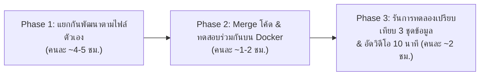

<p align="right">
  <a href="00-tasks-overview.md">🇬🇧 English</a> | <b>🇹🇭 ภาษาไทย</b>
</p>

# 👥 ภาพรวมการแบ่งงานของสมาชิกทั้ง 3 คน (Tasks Overview)

> **รายวิชา:** AI2 (2110477)  
> **สมาชิกในกลุ่ม:**  
> 1. 6631305321 Chanatda Konchom (Fai)  
> 2. 6632213421 Sasarose Buranapin (Rose)  
> 3. 6630333721 Sippapas Chavanont (Mai)  
>  
> เอกสารนี้สรุปการแบ่งความรับผิดชอบของสมาชิกทั้ง 3 คนในทีม **ExamAnt** ให้ครบถ้วนตามขอบเขต 24 person-hours และสามารถแยกกันพัฒนาคู่ขนานได้ทันทีโดยไม่ติดคอขวด

---

## 1. ตารางสรุปบทบาทและไฟล์ที่รับผิดชอบ

| สมาชิก | บทบาทหลัก | ไฟล์หลักที่รับผิดชอบ | Branch ที่ได้รับมอบหมาย | เอกสารคู่มือเฉพาะตัว |
| :--- | :--- | :--- | :--- | :--- |
| **6630333721 Sippapas Chavanont (Mai)** | กำหนดสเปกกลาง, พัฒนาอัลกอริทึม **ACO** และ **Random Feasible**, ตรวจสอบความถูกต้องของผลลัพธ์ `/solve` และ `/compare` | - `backend/app/algorithms/aco.py`<br>- `backend/app/algorithms/random_feasible.py`<br>- `backend/app/routers/solver.py` | `feat/aco-random-solvers` | 👉 [01-task-maimai-lead-aco.th.md](01-task-maimai-lead-aco.th.md) |
| **6631305321 Chanatda Konchom (Fai)** | Setup Repository & Docker, ออกแบบและสร้าง **Dataset Generator (3 ระดับความยาก)** + **MongoDB Seeder**, พัฒนาอัลกอริทึม **Greedy** | - `docker-compose.yml`<br>- `backend/scripts/seed_db.py`<br>- `backend/app/algorithms/greedy.py` | `feat/dataset-seeder-greedy` | 👉 [02-task-fai-db-greedy.th.md](02-task-fai-db-greedy.th.md) |
| **6632213421 Sasarose Buranapin (Rose)** | พัฒนาหน้าเว็บ **Streamlit Frontend**, ตกแต่งตารางสอบสี 2 ช่วง/วัน, กราฟเปรียบเทียบผล 3 อัลกอริทึม และรันการทดลองสรุปผลสำหรับวิดีโอ 10 นาที | - `frontend/app.py`<br>- `frontend/components/sidebar.py`<br>- `frontend/components/schedule_grid.py`<br>- `frontend/components/charts.py` | `feat/streamlit-frontend-viz` | 👉 [03-task-rose-frontend.th.md](03-task-rose-frontend.th.md) |

---

## 2. กฎการทำงานร่วมกันบน Git (Branch Naming & Commit Messages)

> อ้างอิงแนวทางปฏิบัติที่ดีจาก [Git Good: Best Practices for Branch Naming and Commit Messages](https://dev.to/shnjd/git-good-best-practices-for-branch-naming-and-commit-messages-oj4) สรุปให้กระชับสำหรับทีมดังนี้:

### 2.1 ขั้นตอนและรูปแบบการตั้งชื่อ Branch
1. **ดึงโค้ดล่าสุดจาก `main` ทุกครั้งก่อนแตก Branch:**
   ```bash
   git checkout main
   git pull origin main
   git checkout -b <branch-name>
   ```
2. **รูปแบบการตั้งชื่อ Branch:** `<type>/<short-description-in-kebab-case>`
   - ใช้ตัวพิมพ์เล็กทั้งหมด คั่นด้วยเครื่องหมายขีดกลาง `-` (ห้ามใช้อักษรพิมพ์ใหญ่ ขีดล่าง หรือเว้นวรรค)
   - คำนำหน้า (Prefix) ที่ใช้บ่อย:
     - `feat/`: ฟีเจอร์ใหม่, อัลกอริทึม หรือหน้า UI ใหม่ (เช่น `feat/aco-random-solvers`)
     - `fix/`: แก้ไขบั๊ก (เช่น `fix/conflict-validator`)
     - `refactor/`: ปรับปรุงโครงสร้างโค้ดโดยไม่เปลี่ยนผลลัพธ์การทำงาน
     - `docs/`: แก้ไขหรือเพิ่มเอกสาร Markdown
     - `test/`: เพิ่มหรือแก้ไขชุดทดสอบ
     - `chore/`: อัปเดตการตั้งค่า, Library หรือ Tooling

### 2.2 กฎการเขียน Commit Message (Conventional Commits)
- **โครงสร้าง:**
  ```text
  <type>(<scope-ถ้ามี>): <คำอธิบายสั้นๆ เชิงสั่งการ (Imperative mood)>

  [คำอธิบายเพิ่มเติมว่าแก้ "อะไร" และ "ทำไม" บรรทัดละไม่เกิน ~72 ตัวอักษร]
  ```
- **กติกาสำคัญในบรรทัดแรก (Subject Line):**
  - **ใช้กริยาเชิงสั่งการ (Imperative Mood):** เช่น `feat(aco): add transition probability selection` (ไม่ใช่ *"added"* หรือ *"adds"*)
  - **ขึ้นต้นด้วยตัวพิมพ์เล็ก** หลังเครื่องหมายโคลอน `:` และ **ห้ามใส่จุด `.` ปิดท้ายประโยค**
  - **ความยาวกระชับ:** บรรทัดแรกไม่เกิน 50 ตัวอักษร
- **Type มาตรฐาน:** `feat`, `fix`, `docs`, `refactor`, `perf`, `test`, `chore`

---

## 3. ทำไมทั้ง 3 คนถึงเริ่มทำพร้อมกันได้ทันทีโดยไม่ต้องรอกัน?

ในการ Setup Repository รอบนี้ เราได้เตรียม **"โครงสร้างเชื่อมกลาง (Shared Glue & Starter Stubs)"** ไว้ให้แล้ว:
1. **มีข้อมูลตัวอย่าง `demo_01` พร้อมใช้งานทันที:** ไมไมและโรสสามารถรันทดสอบโค้ดของตัวเองกับ `demo_01` ได้ตั้งแต่วันแรก ในระหว่างที่ฝ้ายกำลังสร้างชุดข้อมูล `easy_01`, `medium_01`, `hard_01` เพิ่มเติม
2. **มีโมดูลกลาง `ConflictGraph` และ `Central Validator` (`backend/app/core/`):** ทั้งฝ้าย (Greedy) และไมไม (Random Feasible & ACO) เรียกใช้ฟังก์ชันเช็กการชน (`get_feasible_slots`) และคำนวณคะแนนสอบติดกัน (`calculate_delta_penalty`) จากที่เดียวกัน จึงมั่นใจได้ว่ากติกาของทั้ง 3 อัลกอริทึมตรงกัน 100%
3. **มี API Stub ที่คืนค่าตามจริงทุกฟิลด์:** โรสสามารถรัน `docker compose up` แล้วเขียนหน้า Streamlit ดึงข้อมูลจาก `/instances`, `/solve`, `/compare` ได้ทันทีโดยไม่ต้องรอให้ไมไมและฝ้ายเขียนอัลกอริทึมเสร็จสมบูรณ์ก่อน

---

## 4. แผนเวลาและลำดับการรวมงาน (Integration Roadmap — 24 Person-Hours)



### Checklist ก่อนอัดวิดีโอนำเสนอ 10 นาที
- [ ] **ฝ้าย:** มีชุดข้อมูลอย่างน้อย 3 ชุดใน MongoDB (`easy_01`, `medium_01`, `hard_01` หรือ `demo_01..03`) ที่ยืนยันแล้วว่าจัดตารางไม่ชนได้จริง และอัลกอริทึม Greedy เลือกช่วงสอบที่เพิ่ม Penalty น้อยที่สุดแล้ว
- [ ] **ไมไม:** อัลกอริทึม Random Feasible และ ACO ทำงานครบตามสมการใน `AI2 Slide.pdf` และส่งข้อมูล `history` ราย Iteration กลับไปให้กราฟ Convergence ได้จริง
- [ ] **โรส:** หน้าเว็บ Streamlit แสดงตารางสอบสี, รายชื่อนักศึกษาที่สอบติดกัน, กราฟ Convergence และตารางสรุปผลเปรียบเทียบทั้ง 3 วิธีพร้อมใช้อัดวิดีโอ
